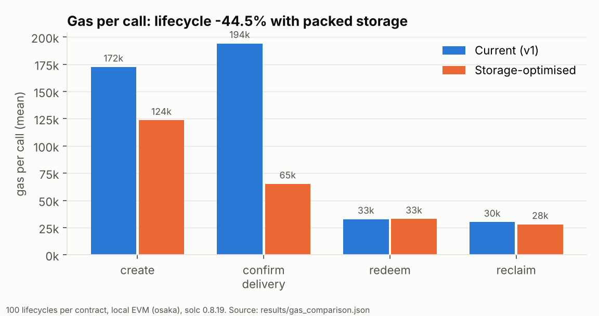
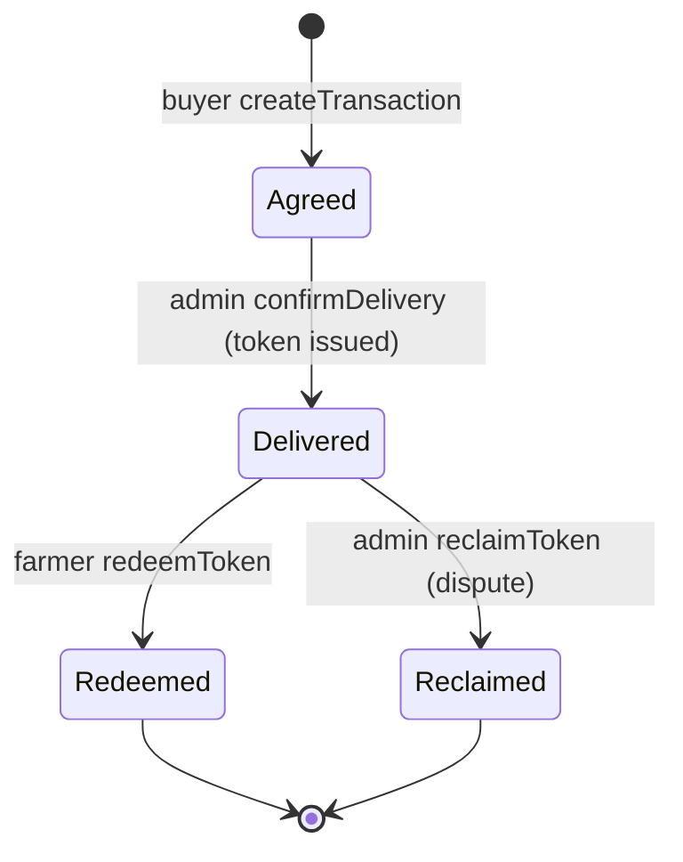
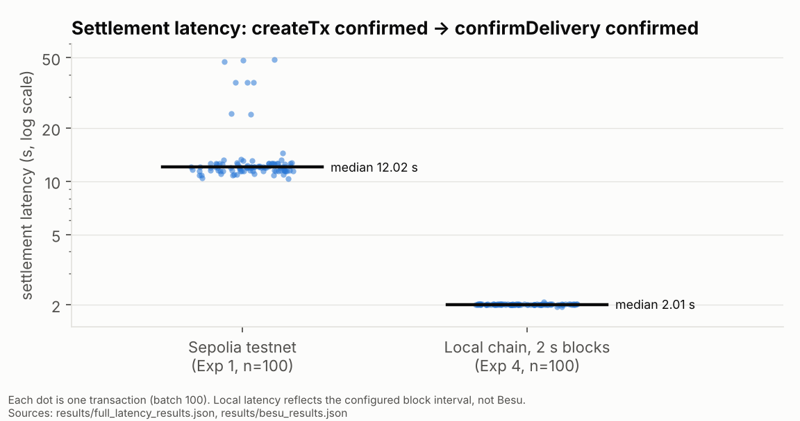

# Agri-Yield Chain — Blockchain Settlement for Farmer–Buyer Trades

[](https://github.com/RebekahZx/agri-settlement-chain/actions/workflows/test.yml)

A Solidity smart contract (plus an escrow-based v2) that records an agricultural produce agreement between
a registered buyer and farmer, an admin-confirmed delivery, and a settlement
token (`ACTIVE → REDEEMED | RECLAIMED`). There are also experiment scripts that
measure the contract's latency, gas and illustrative cost on Ethereum Sepolia
and on a local chain, and compare it with an in-memory REST API and Indian bank
transfer fees.

**Highlights**

- **−44.5% lifecycle gas** with a storage-optimised contract (`confirmDelivery`
  −66.5%, `createTransaction` −28.4%). Behaviour is verified identical by the
  full test suite plus a 300-step differential test. The local measurement
  method was validated against the stored Sepolia data (within 0.04%).
- **An escrow contract** with cancel/refund and pull-pattern withdrawals,
  tested against a reentrancy attacker and a randomised balance invariant.
- **A bug fix**: the deployed contract could mint a settlement token for a
  non-existent transaction.
- **Slither** static analysis in CI, with findings triaged in
  [`docs/security.md`](docs/security.md).
- A short technical report: [`docs/report.md`](docs/report.md).



> **Scope note.** In v1 (and its optimised variant) the settlement token is a
> **status record**: the contract does not escrow or transfer ETH or any ERC-20
> value (v2, `EscrowSettlement`, does hold funds; see below); payment itself is assumed
> to happen off-chain. What the chain adds is a shared, tamper-evident
> record of each step.

## Repository layout

| Path | Purpose |
|---|---|
| `contracts/SettlementSystem.sol` | v1 settlement contract (status records only; used by all experiments) |
| `contracts/SettlementSystemOptimized.sol` | Same behaviour as v1 with packed storage (−44.5% lifecycle gas) |
| `contracts/reference/SettlementSystemV0.sol` | Unmodified original source (renamed), used to validate gas measurements against Sepolia |
| `contracts/EscrowSettlement.sol` | v2: same lifecycle with real ETH escrow, cancel/refund and pull-payment withdrawals |
| `contracts/test/ReentrantBuyer.sol` | Test-only attacker/rejecting-receiver contracts |
| `test/Equivalence.test.js` | Differential test: v1 vs optimised on 300 random calls |
| `test/EscrowSettlement.test.js` | v2 tests: lifecycle, refunds, reentrancy, accounting invariant |
| `test/SettlementSystem.test.js` | Contract unit tests (Hardhat + chai) |
| `test/rest_server.test.js` | REST baseline API tests |
| `src/rest_server.js` | In-memory REST API with the same lifecycle (baseline) |
| `scripts/deploy.js` | Deploy to Sepolia → `results/deployment.json` |
| `scripts/exp1_sepolia_latency.js` | Exp 1: settlement latency + gas on Sepolia |
| `scripts/exp2_failure_dispute.js` | Exp 2: redeem (happy) vs reclaim (dispute) paths on Sepolia |
| `scripts/exp3_rest_baseline.js` | Exp 3: same lifecycle against the REST API |
| `scripts/exp4_besu_inprocess.js` | Exp 4: local Hardhat chain, 2 s blocks (Besu stand-in) |
| `scripts/exp5_local_concurrency.js` | Exp 5: concurrent (non-sequential) submission on the local chain |
| `scripts/exp4_besu.js`, `scripts/deploy_besu.js` | Exp 4 variant against a separate `npx hardhat node` |
| `scripts/gas_comparison.js` | Gas per function for V0 / v1 / optimised → `results/gas_comparison.json` |
| `scripts/plot_results.py` | Figures in `docs/figures/` from `results/` |
| `scripts/combine_results.js` | Merges `results/` → `combined_results.json`, `cost_analysis.json` |
| `scripts/experiment.js` | Legacy createTransaction-only run (produced `results/results.json`) |
| `results/*.json` | Stored deployment info and experiment outputs (see below) |
| `data/` | All-India crop area/production/yield CSV (context only; see `data/README.md`) |
| `.github/workflows/test.yml` | CI: tests and Slither on every push / PR |
| `docs/report.md`, `docs/security.md` | Technical report; security review |

## Contract lifecycle

1. **Admin** registers farmers and buyers.
2. A **buyer** calls `createTransaction(farmer, produceType, quantityKg, agreedPriceINR)`.
3. **Admin** calls `confirmDelivery(txId)`, which marks delivery confirmed and
   issues an `ACTIVE` settlement token for the agreed amount.
4. Either the **farmer** calls `redeemToken(tokenId)` → `REDEEMED`,
   or the **admin** calls `reclaimToken(tokenId)` (dispute) → `RECLAIMED`.



## v2: EscrowSettlement

`SettlementSystem` only records state; payment happens elsewhere.
`EscrowSettlement` makes the settlement real:

- `createAgreement(farmer, produceType, quantityKg)` is `payable`. The buyer's
  payment is held by the contract.
- Before delivery, the buyer (or admin) can `cancelAgreement` for a refund.
- After `confirmDelivery`, `redeemToken` pays the farmer and `reclaimToken`
  (dispute) refunds the buyer.
- Payouts are credited to `pendingWithdrawals` and claimed with `withdraw()`
  (pull pattern, state updated before the transfer).
- The contract tracks `totalEscrowed` and `totalOwed`. The tests check after
  every step of a randomised 200-operation sequence that the contract's ETH
  balance always equals their sum.

The tests include a contract that tries to re-enter `withdraw()` while being
paid. It receives the funds exactly once. As a check that this test is
meaningful, it fails if `withdraw()` is changed to pay before clearing the
balance.

v2 has not been deployed to Sepolia or measured in the experiments; all
stored results refer to v1.

Trust model (both versions): the admin is a single trusted party. It confirms deliveries and
resolves disputes, and there is no multi-party approval, timeout or appeal.

## Licence

MIT — see `LICENSE`.

## Setup

```bash
npm ci
npx hardhat compile
npm test            # unit tests for both contracts and the REST API
npm run test:gas    # same, plus a per-function gas table
```

The Sepolia experiments need a `.env` (see `.env.example`) with `SEPOLIA_URL`
and `PRIVATE_KEY` for a funded **testnet** account. Never commit `.env`.

## Running the experiments

```bash
npm run exp3:rest                 # REST baseline, no chain needed
npm run exp4:local                # local Hardhat chain, ~2 s per block
npm run exp5:local                # concurrent submission on the local chain
npx hardhat run scripts/deploy.js --network sepolia
npm run exp1:sepolia              # costs testnet ETH, takes hours
npm run exp2:sepolia
ETH_PRICE_USD=2058.06 npm run combine   # pin the ETH price for reproducibility
npm run gas:compare               # deterministic gas comparison (local)
pip install matplotlib && python scripts/plot_results.py   # figures
```

To measure the **optimised contract on Sepolia**, without touching the
stored v1 results (outputs go to `results/sepolia-optimized/`):

```bash
npm run sepolia:opt:deploy
npm run sepolia:opt:exp1          # ~225 create+confirm pairs; takes hours
npm run sepolia:opt:exp2          # 50 redeem + 50 reclaim lifecycles
```

The scripts refuse to overwrite an existing result file unless `OVERWRITE=1`
is set, and Exp 1/2 check that `deployment.json` matches `CONTRACT`.

`BATCH_SIZES=10,20` overrides batch sizes for Exp 3 and Exp 4 (for quick
smoke runs; the reported results use 100, 500 and 1000).

Scripts read and write `results/`. **Running an experiment overwrites its
result file there**; set `RESULTS_DIR=some/other/dir` to keep the stored
results untouched (copy `results/deployment.json` there first for Exp 1/2).

## Stored results (original measurements)

These are the results already in the repository, produced in March 2026 by
the **original** version of the contract and scripts (`results/combined_results.json`
was generated 2026-03-31). They have not been re-measured; the numbers below
are copied from the JSON files.

### Exp 1 — Sepolia settlement latency (createTx confirmed → confirmDelivery confirmed)

| Batch | Measured tx | Median (s) | IQR (s) | p95 (s) | createTx gas | confirmDelivery gas |
|---|---|---|---|---|---|---|
| 100 | 100 | 12.02 | 1.09 | 36.11 | 172,421 | 194,021 |
| 500 | 75 (sample) | 11.98 | 0.87 | 16.34 | 172,421 | 194,026 |
| 1000 | 50 (sample) | 12.03 | 1.13 | 24.64 | 172,421 | 194,026 |

### Exp 2 — Sepolia full lifecycle (n = 50 each)

| Path | Median lifecycle (s) | Mean total gas | Final-step gas |
|---|---|---|---|
| Happy (create → confirm → redeem) | 35.69 | 399,245 | 32,798 (redeem) |
| Dispute (create → confirm → reclaim) | 35.78 | 396,525 | 30,079 (reclaim) |

### Exp 3 — REST baseline (full create → confirm → redeem request lifecycle)

| Batch | Median (ms) | p95 (ms) | Requests/s |
|---|---|---|---|
| 100 | 2.0 | 3.0 | 224.22 |
| 500 | 1.0 | 2.0 | 711.24 |
| 1000 | 1.5 | 2.0 | 654.45 |

### Exp 4 — Local Hardhat chain, 2 s interval mining (all transactions measured)

| Batch | Median settlement (s) | IQR (s) | p95 (s) |
|---|---|---|---|
| 100 | 2.012 | 0.005 | 2.018 |
| 500 | 2.014 | 0.006 | 2.022 |
| 1000 | 2.015 | 0.009 | 2.027 |

### Cost (`results/cost_analysis.json`)

Measured lifecycle gas is 399,240 units (create + confirm + redeem). At the
recorded Sepolia gas price (0.0591 gwei) and ETH = $2058.06, that is
0.0000236 ETH ≈ $0.049 ≈ ₹4.05. NEFT (₹2.5), RTGS (₹25) and UPI (₹0) come from
published fee schedules, not measurements.

## Gas optimisation (new measurement, October 2026)

Measured with `scripts/gas_comparison.js`: 100 identical lifecycles per
contract on a local EVM (Hardhat, `osaka`, solc 0.8.19, optimizer 200 runs),
after one warm-up lifecycle. Gas is deterministic, so this carries over to
any EVM chain with the same gas schedule. As a check, the original deployed
source measured this way matches the stored Sepolia means within 0.04% for
all four functions.

| Function | v1 | Optimised | Change |
|---|---|---|---|
| createTransaction | 172,479 | 123,545 | −28.4% |
| confirmDelivery | 194,149 | 65,136 | −66.5% |
| redeemToken | 32,786 | 32,993 | +0.6% |
| reclaimToken | 30,067 | 27,997 | −6.9% |
| Lifecycle (create + confirm + redeem) | 399,414 | 221,674 | −44.5% |

What changed: agreements are packed from 7 storage slots into 4, and a token
is one slot referencing its agreement instead of a 4-slot copy. See
`contracts/SettlementSystemOptimized.sol` and `docs/report.md` §4.



## Sepolia deployment of the optimised contract (October 2026)

`SettlementSystemOptimized` is deployed on Ethereum Sepolia at
[`0xf937809C96F61fb4939f07572Cc19cf11ca2928F`](https://sepolia.etherscan.io/address/0xf937809C96F61fb4939f07572Cc19cf11ca2928F)
(deploy tx [`0x6ccb…b823`](https://sepolia.etherscan.io/tx/0x6ccb9bc767afef0d52b1c8edf3121a281ec6adf2c8eddee79ae1b1063c7fb823),
2026-10-14; record in `results/sepolia-optimized/deployment.json`).

Deployment used **7,221,912 gas**, versus 1,032,250 gas for the same bytecode
on the local EVM. Sepolia activated the Glamsterdam upgrade on 2026-10-06,
which adds a separate charge for newly created state (EIP-8037), including
deployed code and new storage slots. All stored Sepolia results above were
measured **before** that upgrade, so they are not directly comparable with
measurements taken after it; a same-network re-run of v1 and the optimised
contract (`npm run sepolia:v1:deploy`, `EXP2_N=10 npm run sepolia:v1:exp2`,
`EXP2_N=10 npm run sepolia:opt:exp2`) is the planned comparison.

## Experiment 5 — concurrent submission (no stored results yet)

Experiments 1–4 send one transaction and wait for it before sending the next,
so their TPS describes that loop. Exp 5 submits a whole batch of
`createTransaction` calls (then a batch of `confirmDelivery` calls) without
waiting, using consecutive nonces from one account. It records wall time,
chain-side time from block timestamps, blocks used, and transactions and gas
per block.

On this local chain, throughput is set by how many transactions fit in each
2 s block, so the result characterises the simulated chain's configuration,
not Besu or Ethereum. Run `npm run exp5:local` to produce
`results/exp5_concurrency_results.json`.

## How to read these results (limitations)

- **Sepolia is a testnet.** Its gas price is far below mainnet's, so the
  ETH/USD/INR cost is illustrative. Gas *units* carry over to any EVM chain;
  the *price* does not.
- **Exp 4 is not Besu.** It is one Hardhat node with 2 s interval mining. It
  matches Besu on EVM bytecode (so gas units are comparable) but does not model
  BFT consensus, multiple validators or network latency. The ~2.0 s settlement
  latency is the configured block interval, and the ~0.25 TPS reflects the
  sequential submit-and-wait loop. Neither is a measurement of Besu performance.
  "Zero gas cost" assumes a private network configured with gas price 0.
- **"Batches" are sequential.** Every transaction is submitted and awaited one
  at a time, so batch size changes the sample size, not the load. TPS values
  describe that loop, not network capacity. Sampled Sepolia batches (500/1000)
  are **not** extrapolated.
- **Different intervals.** Blockchain "settlement latency" starts when
  `createTransaction` is confirmed. REST latency covers the whole
  create → confirm → redeem lifecycle. Blockchain settlement latency also
  includes the scripts' fixed cooldown between the two calls (300 ms on Sepolia,
  10 ms locally). The comparison is order-of-magnitude, not like-for-like.
- **REST timing resolution.** REST latencies use `Date.now()` (1 ms
  resolution), so sub-millisecond values are quantised.
- **"Settlement certainty" = 100%** is hard-coded in the scripts for runs
  that completed without throwing. It is not an independently measured rate.

## Changes since the stored results

The stored results above were produced before these changes:

- **Contract input validation.**
  - `confirmDelivery` now rejects unknown transaction ids. Previously it
    succeeded and issued an `ACTIVE` token for `address(0)` with amount 0.
  - Registration rejects the zero address.
  - `createTransaction` rejects zero quantity and zero price.
  - Measured on a local Hardhat chain, this adds about 46 gas to
    `createTransaction` and 135 gas to `confirmDelivery` (redeem and reclaim
    unchanged). Deployment gas rises from 1,045,362 to 1,121,885.
  - Re-running Exp 1/2 would therefore give slightly different gas figures.
- **REST baseline.** Exp 3 now uses `src/rest_server.js` instead of its own
  inline copy. That copy did not reject double confirmation. The happy-path
  request sequence is unchanged.
- **Cost analysis.** Missing input data now raises an error. Previously,
  hard-coded estimates (130,000 / 30,000 gas, 3 gwei, $3000 ETH) were
  substituted silently. The ETH price can be pinned with `ETH_PRICE_USD`, and
  its source and timestamp are recorded. With `ETH_PRICE_USD=2058.06` the
  script reproduces the stored `cost_analysis.json` numbers exactly.
- **Tests.** Added unit tests for both contracts and the REST API (`npm test`),
  plus an optional gas report (`npm run test:gas`).
- **v2 escrow contract and Exp 5.** New; see the sections above.
- **Labels.** Removed "extrapolated" and "equivalent to Besu" wording that the
  code did not support.
- **Layout.** Result files moved from the repository root into `results/`;
  added CI, a licence, and the crop dataset under `data/`.

The stored Sepolia deployment (`results/deployment.json`, gas 1,045,362) matches the
deployment gas of the original contract source, which confirms the stored
results came from that version.
